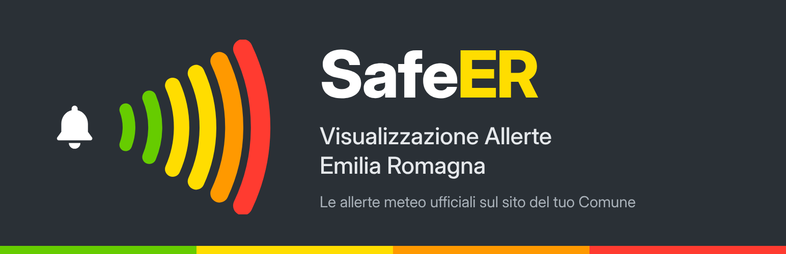
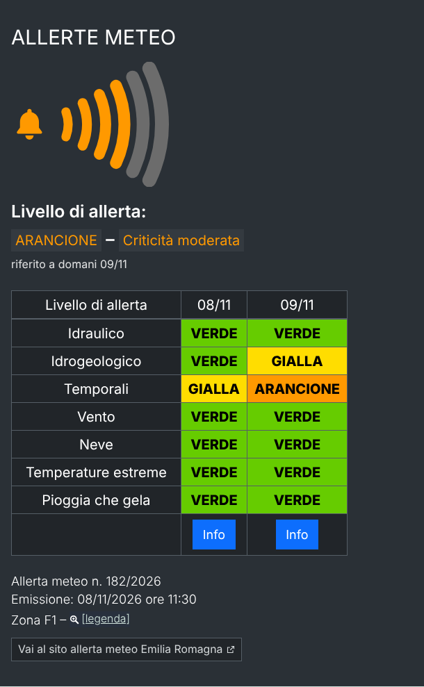

# SafeER Visualizzazione Allerte Emilia Romagna



Plugin WordPress che mostra sul sito di un Comune il **documento di allertamento meteo-idrogeologico-idraulico** pubblicato ogni giorno dalla Regione Emilia-Romagna, per la zona di allerta scelta.

Il plugin è stato sviluppato per gli enti dell'**Unione delle Terre d'Argine** (Unione e Comuni di Carpi, Campogalliano, Novi di Modena e Soliera), ma può essere usato da qualsiasi Comune o ente dell'Emilia-Romagna: basta scegliere la propria zona di allerta.

- **wordpress.org:** https://wordpress.org/plugins/safeer-visualizzazione-allerte-emilia-romagna/
- **Licenza:** GPLv2 o successiva
- **Requisiti:** WordPress 5.8+, PHP 7.4+

> SafeER è un plugin indipendente, sviluppato da Maurizio Malagoli ([malamaur](https://profiles.wordpress.org/malamaur/)). Non è affiliato né approvato dalla Regione Emilia-Romagna o dal servizio Allerta Meteo Emilia-Romagna: si limita a mostrare i dati pubblici che questi pubblicano.

## Cosa mostra



- Livello di allerta complessivo (verde, gialla, arancione, rossa) con la campana e il giorno a cui si riferisce.
- Tabella dei fenomeni per oggi e domani: idraulico, idrogeologico, temporali, vento, neve, temperature estreme, pioggia che gela; stato del mare e mareggiate per le zone costiere.
- Numero e data di emissione del bollettino, note in una finestra "Info" con il link al documento ufficiale (PDF) della Regione, legenda delle 18 zone di allerta.
- Facoltativo: link al portale regionale.

I dati vengono dal servizio CAP (Common Alerting Protocol) `https://allertameteo.regione.emilia-romagna.it/o/xmlcap`, con cache configurabile (30 minuti di default). Se il servizio non risponde viene mostrata l'ultima copia valida con un avviso.

## Installazione

1. Da WordPress: **Plugin › Aggiungi nuovo**, cerca "SafeER" e installa. In alternativa scarica lo zip da wordpress.org o dalle [Release](../../releases).
2. Attiva il plugin.
3. **Impostazioni › SafeER Allerte**: scegli la zona di allerta (i Comuni dell'Unione delle Terre d'Argine sono in F1), il logo, i colori e gli elementi da mostrare. L'anteprima in cima alla pagina si aggiorna al salvataggio.
4. Inserisci lo shortcode `[allerta_meteo]` in una pagina, oppure usa il widget **SafeER Allerte**.

### Shortcode

```
[allerta_meteo]
[allerta_meteo zona="F1" comune="Carpi" titolo="Allerta meteo" logo="https://…/logo.png" sfondo="#1d3557" testo="#ffffff" domani="si" campana="si" info="si" pdf="si" emissione="si" giorno="si" legenda="si" link="si"]
```

Gli attributi omessi usano i valori delle impostazioni.

### Personalizzare la grafica dal tema

I colori sono variabili CSS sul contenitore `.amer`:

```css
.amer {
	--amer-bg: #1d3557;
	--amer-l1: #ffd400; /* gialla */
}
```

## Sviluppo

| Cartella / file | Contenuto |
| --- | --- |
| `safeer-visualizzazione-allerte-emilia-romagna.php` | Codice del plugin |
| `assets/` | CSS e JS caricati sul sito |
| `readme.txt` | Readme di wordpress.org (pagina pubblica del plugin) |
| `.wordpress-org/` | Banner, icona e screenshot della pagina wordpress.org |
| `.github/workflows/` | Automatismi (vedi sotto) |

### Rilasciare una nuova versione

Il repository SVN di wordpress.org viene aggiornato da GitHub Actions, senza usare un client SVN.

1. Aggiorna il numero di versione in tre punti: intestazione `Version:` e costante `VERSION` nel file principale, `Stable tag:` in `readme.txt`. Aggiungi la voce al `== Changelog ==`.
2. Fai commit su `main`.
3. Crea un tag con lo stesso numero, ad esempio `2.3.1`, oppure una Release da GitHub. Il workflow **Deploy su WordPress.org** pubblica `trunk`, `tags/2.3.1` e le immagini.

Modifiche solo a `readme.txt` o a `.wordpress-org/` sul branch `main` vengono pubblicate dal workflow **Aggiorna readme e immagini**, senza nuova versione.

**Plugin Check** gira a ogni push e pull request.

I workflow di pubblicazione richiedono due secret in **Settings › Secrets and variables › Actions**:

- `SVN_USERNAME`: `malamaur`
- `SVN_PASSWORD`: la password SVN di wordpress.org, impostata in [Account & Security](https://profiles.wordpress.org/me/profile/edit/group/3/?screen=svn-password). È diversa dalla password del sito.

## Licenza

GPLv2 o successiva. Vedi [LICENSE](LICENSE).
